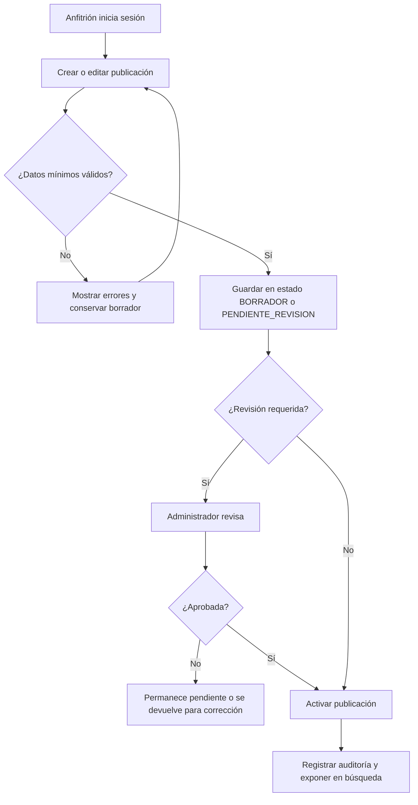
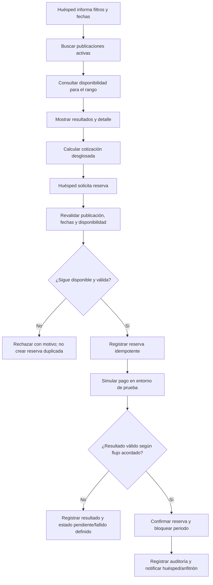
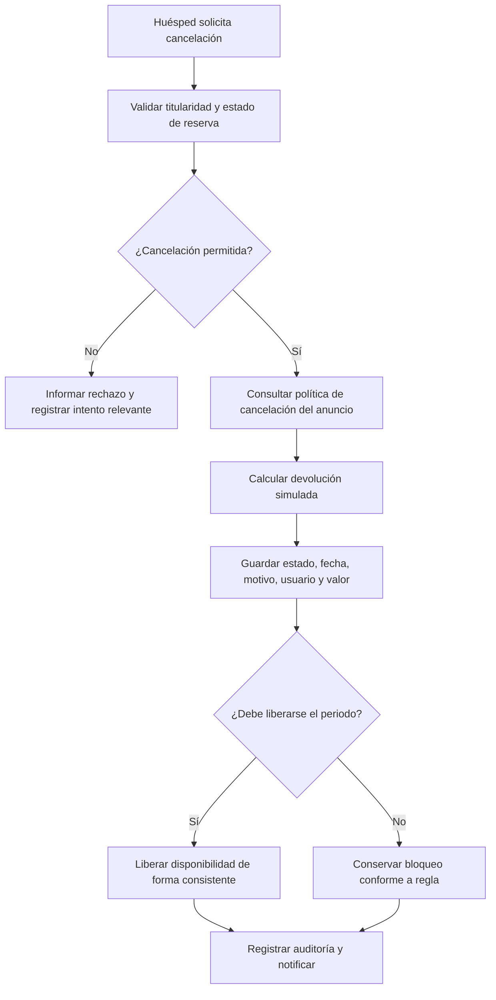
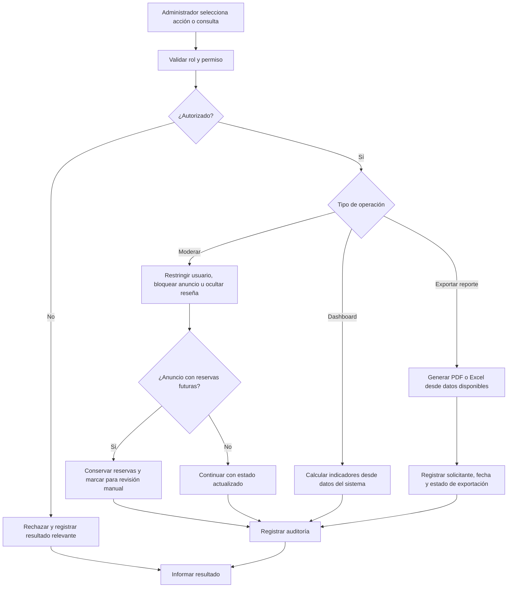

# 3. Procesos de negocio

Los modelos se derivan de los procesos sugeridos en la guía. Los diagramas Mermaid son vistas legibles del flujo; los archivos fuente BPMN 2.0 asociados se versionarán en `docs/entrega-1/bpmn/` y deben abrirse en una herramienta compatible para validación visual antes de la sustentación.

## PB-01 — Incorporación y publicación de alojamiento

**Objetivo:** permitir que un anfitrión mantenga una publicación completa y controlada.  
**Límite:** inicia cuando el anfitrión autenticado crea una publicación y termina cuando queda activa o permanece pendiente de corrección/revisión.  
**Participantes:** anfitrión, marketplace, administrador/moderador.  
**Entradas:** perfil autorizado, datos mínimos del anuncio, ubicación textual, tipo, capacidad, precio, servicios, reglas, referencias de imágenes y política de cancelación.  
**Reglas:** cada publicación tiene un único anfitrión; solo anfitrión y administrador autorizado pueden modificarla; capacidad > 0; precio por noche > 0; solo publicaciones activas aparecen en búsqueda/reciben reservas.  
**Salida:** publicación guardada con estado y evento de auditoría.

**Eventos:** `ListingCreated`, `ListingUpdated`, `ListingSubmittedForReview`, `ListingActivated`, `ListingPaused`, `ListingBlocked`.  
**Indicadores propuestos:** publicaciones activas, tiempo entre creación y activación, publicaciones devueltas/bloqueadas.

## PB-02 — Descubrimiento, disponibilidad, cotización y reserva

**Objetivo:** llevar al huésped desde la búsqueda hasta una reserva confirmada sin solapamiento.  
**Límite:** inicia cuando el huésped envía filtros y fechas, termina cuando la reserva queda confirmada o se informa que no pudo confirmarse.  
**Participantes:** huésped, catálogo/búsqueda, disponibilidad, cotización, reservas, proveedor de pagos de prueba y notificaciones.  
**Entradas:** ciudad, llegada, salida, capacidad, tipo, rango de precio, servicios, publicación elegida y clave de idempotencia.  
**Reglas:** salida > llegada; capacidad y precio válidos; publicación activa; disponibilidad se verifica de nuevo al confirmar; no hay reservas solapadas; total incluye base, limpieza, servicio, descuentos y extras; pago es simulado; reintentos no deben duplicar reservas.

**Nota de diseño:** el enunciado requiere confirmar consistencia y evitar duplicados; no precisa exactamente el comportamiento transaccional frente a un fallo de Stripe test. La política de estado ante pago fallido debe acordarse y documentarse antes de implementarse.  
**Salida:** reserva y estado consultables, periodo bloqueado si se confirma, notificaciones y auditoría.  
**Indicadores:** reservas por estado, conversión de búsqueda a reserva, fallos por falta de disponibilidad, ingresos estimados (no cobros reales).

## PB-03 — Cancelación y liberación de disponibilidad

**Objetivo:** aplicar la política asociada al alojamiento, registrar el resultado y liberar el periodo si corresponde.  
**Límite:** inicia con la solicitud de cancelación y finaliza con el estado final, devolución simulada y notificación.  
**Participantes:** huésped, reservas, política de cancelación, disponibilidad, notificaciones y auditoría.  
**Entradas:** reserva, usuario autenticado, motivo y política de publicación.  
**Reglas:** guardar usuario, fecha, motivo, devolución aplicable y estado final; liberar fechas solo cuando lo determine la política/regla del sistema; importe de devolución es académico/simulado.

## PB-04 — Moderación, auditoría y reportes

**Objetivo:** controlar contenido y cuentas, dejar evidencia de operaciones y ofrecer información consistente para la gestión.  
**Límite:** inicia cuando un administrador autorizado selecciona una acción o un reporte y termina con el cambio/consulta registrada y su resultado auditable.  
**Participantes:** administrador, marketplace, auditoría, publicación/reserva/reseña y módulo de dashboard/reportes; dirección de Inversiones LR como interesada que consume resultados.  
**Entradas:** usuario/publicación/reseña a moderar y motivo; o tipo de reporte, formato, filtros y parámetros de consulta.  
**Reglas:** acción administrativa solo para rol autorizado; anuncio bloqueado no elimina reservas futuras, que pasan a revisión manual; los cambios relevantes se auditan; dashboard y exportaciones corresponden con información disponible; PDF/Excel debe registrar solicitante y fecha/hora.  
**Salidas:** cuenta/publicación/reseña con estado actualizado, reservas futuras conservadas y señaladas cuando aplica, evento de auditoría consultable, indicadores del dashboard o reporte exportado con estado de generación.  
**Eventos:** `UserRestricted`, `ListingBlocked`, `ReviewHidden`, `AuditEventRecorded`, `ReportRequested`, `ReportExported`, `ReportExportFailed`.

**Indicadores:** usuarios, publicaciones activas, reservas por estado, ingresos estimados y ciudades con mayor demanda. Definición exacta de “ingreso estimado”, periodo de corte y filtros del reporte debe quedar aprobada; la guía no fija una fórmula específica.

## Relación proceso–requerimiento

| Proceso | Requerimientos principales | Historias iniciales |
|---|---|---|
| PB-01 Publicación | RF-004 a RF-006; RN-001 a RN-006 | HU-04, HU-05 |
| PB-02 Búsqueda/reserva | RF-007 a RF-012; RN-007 a RN-010, RN-013, RN-016 | HU-06 a HU-11 |
| PB-03 Cancelación/notificación | RF-013 a RF-014; RN-011 a RN-012 | HU-12, HU-13 |
| PB-04 Reputación, administración y reportes | RF-015 a RF-020; RN-014, RN-017 a RN-019 | HU-14 a HU-19 |

Los identificadores se detallan en el catálogo y backlog. Estos diagramas son propuestas; el equipo debe validar condiciones, estados y excepciones antes de aprobarlos.
