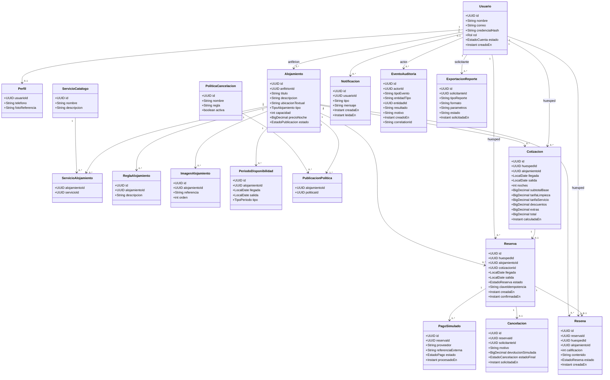

# 7. Modelo de dominio

El siguiente modelo expresa las entidades y asociaciones principales deducidas del glosario y reglas del enunciado. Los tipos/campos son una propuesta conceptual y deben ajustarse al modelo de datos físico y a los servicios finalmente aprobados.

## Conceptos y restricciones

- **Usuario/Rol:** roles de negocio HUÉSPED, ANFITRIÓN y ADMINISTRADOR. A nivel de autorización, validar roles y propiedad del recurso en backend; no depender solo de la interfaz.
- **Alojamiento/estado:** el anuncio no es el inmueble físico por sí solo, sino su representación dentro del marketplace. Tiene un único anfitrión y los estados descritos en el glosario.
- **Servicio (amenity):** facilidad como Wi-Fi o cocina. No confundir con **servicio de software**, que se describe en la arquitectura.
- **Disponibilidad:** representar intervalos de fecha sin permitir nuevos periodos que contradigan reservas confirmadas. Propuesta para fechas: llegada incluida y salida excluida; se debe confirmar como decisión de negocio.
- **Cotización:** almacenar el desglose que se mostró y aceptó, evitando que futuros cambios de tarifa reescriban el histórico de una reserva ya creada.
- **Reserva:** enlaza huésped, alojamiento y periodo. Una restricción de solapamiento efectiva requiere control en la base de datos o transacción equivalente, no solo una validación de frontend.
- **PagoSimulado:** evidencia del resultado de prueba; no es transacción monetaria real.
- **Auditoría vs logs:** auditoría es registro de negocio consultable de acciones con actor/entidad/resultado; los logs técnicos sirven para diagnóstico y deben excluir secretos.
- **Reseña:** solo tras estancia completada, vinculada a la reserva y al alojamiento evaluado. La unicidad (una reseña por reserva) se propone como regla coherente a confirmar.

## Enumeraciones propuestas

| Enumeración | Valores iniciales |
|---|---|
| Rol | HUESPED, ANFITRION, ADMINISTRADOR |
| EstadoCuenta | ACTIVA, DESACTIVADA, RESTRINGIDA |
| EstadoPublicacion | BORRADOR, PENDIENTE_REVISION, ACTIVA, PAUSADA, BLOQUEADA |
| EstadoReserva | SOLICITADA, CONFIRMADA, CANCELADA, COMPLETADA, RECHAZADA, PENDIENTE_PAGO, PAGO_FALLIDO (validar transiciones) |
| EstadoPago | INICIADO, APROBADO_TEST, RECHAZADO_TEST, ERROR_TECNICO |
| EstadoResena | PUBLICADA, OCULTA_POR_MODERACION |
| TipoPeriodo | DISPONIBLE, BLOQUEADO, RESERVADO |

Los estados adicionales de reserva/pago son candidatos de diseño, no una enumeración impuesta literalmente por la guía. El equipo debe aprobar las transiciones y casos de error.
