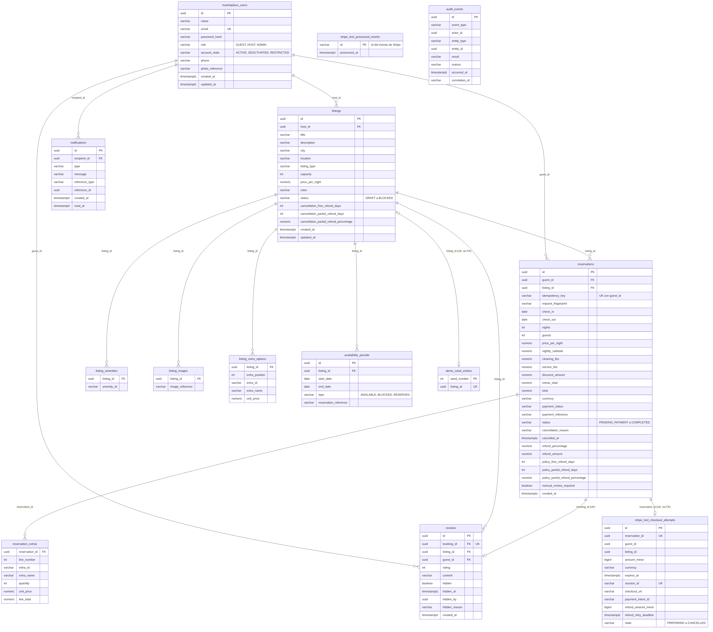
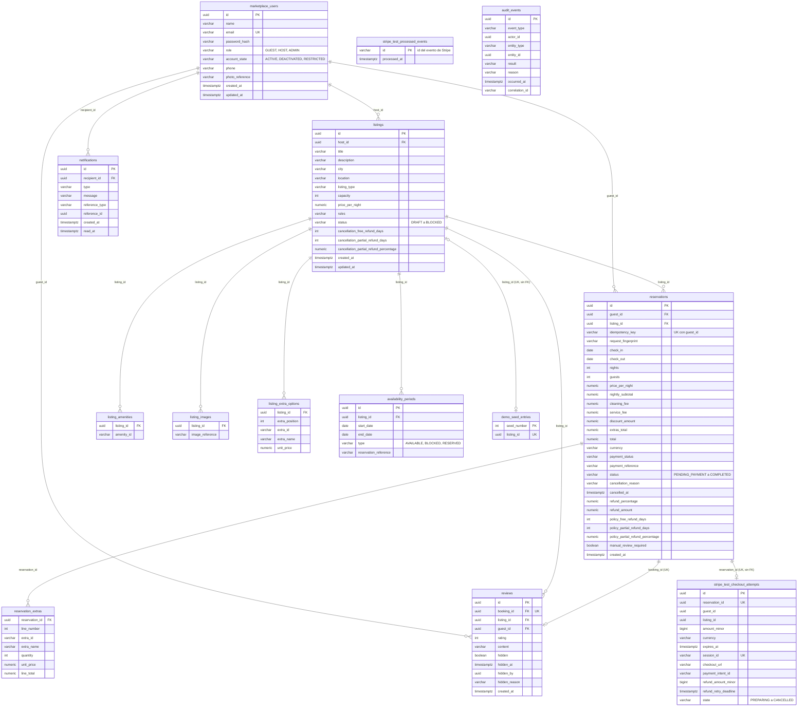
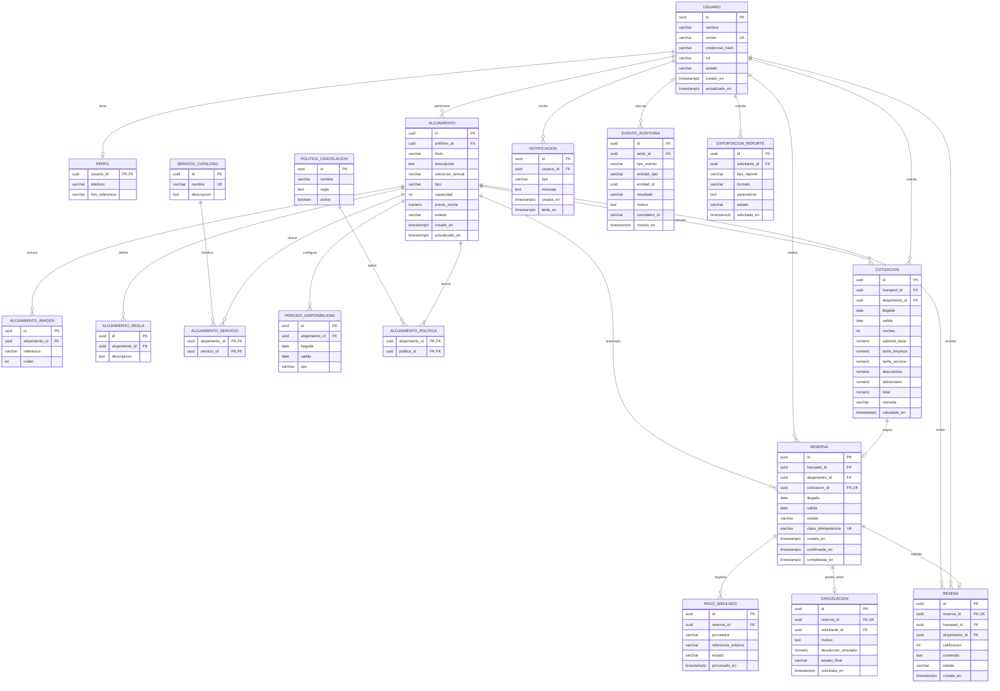

# 8. Modelo de datos

Este documento tiene tres partes. La sección 8.1 es el **modelo físico implementado**: las 14 tablas que Hibernate crea en PostgreSQL a partir de las entidades JPA de `main`. La sección 8.2 conserva el **modelo lógico de diseño** de la Entrega 1 y explica en qué cambió al implementarse. La sección 8.3 verifica la **normalización hasta tercera forma normal** de las 14 tablas implementadas.

## 8.1 Modelo físico implementado

Fuente: anotaciones `@Entity`, `@Table`, `@ElementCollection`, `@JoinColumn` y `@UniqueConstraint` de `backend/src/main/java` (con `ddl-auto: update`) y el script [20261114-reservation-pending-payment.sql](../../backend/deploy/postgresql/20261114-reservation-pending-payment.sql), que amplía la restricción de estados de `reservations`. Son 10 tablas de entidad y 4 tablas de colección (`listing_amenities`, `listing_images`, `listing_extra_options` y `reservation_extras`).

Código fuente del diagrama (Mermaid)

Restricciones relevantes del código:

- `marketplace_users.email` es único; la contraseña se guarda como hash BCrypt en `password_hash`.
- `reservations` tiene la clave única `uk_reservation_guest_idempotency` (`guest_id`, `idempotency_key`): un reintento con la misma clave devuelve la misma reserva.
- `reviews.booking_id` es único (`uk_review_booking`): una reseña por reserva.
- `stripe_test_checkout_attempts` tiene únicos `reservation_id` y `session_id`; guarda `guest_id`, `listing_id` y `reservation_id` como valores sin clave foránea.
- `stripe_test_processed_events` registra el id de cada evento de Stripe ya procesado para no aplicarlo dos veces.
- `audit_events` guarda `actor_id` y `entity_id` sin clave foránea, para que el historial sobreviva a cambios en las entidades.
- El solapamiento de reservas se controla en el servicio con bloqueo pesimista de la publicación y los periodos `RESERVED` de `availability_periods`, no con una restricción de exclusión en la base.

### Correspondencia entre diseño e implementación

| Entidad del diseño (8.2) | Implementación | Cambio |
|---|---|---|
| USUARIO, PERFIL | `marketplace_users` | El perfil (teléfono y foto) se fusionó en la tabla de usuarios. |
| ALOJAMIENTO | `listings` | Igual; la política de cancelación quedó como columnas de la publicación. |
| ALOJAMIENTO_IMAGEN | `listing_images` | Tabla de colección con la referencia de imagen. |
| SERVICIO_CATALOGO, ALOJAMIENTO_SERVICIO | `listing_amenities` | No hay catálogo en base: los servicios son identificadores de texto. |
| ALOJAMIENTO_REGLA | `listings.rules` | Texto en la publicación. |
| (no estaba) | `listing_extra_options`, `reservation_extras` | Extras con precio por publicación y su copia en cada reserva. |
| PERIODO_DISPONIBILIDAD | `availability_periods` | Igual, con `reservation_reference` para los periodos reservados. |
| POLITICA_CANCELACION, ALOJAMIENTO_POLITICA | Columnas `cancellation_*` de `listings` y `policy_*` de `reservations` | La reserva conserva la política vigente al reservar. |
| COTIZACION | Columnas de desglose de `reservations` | La cotización no se guarda; la reserva congela el desglose aceptado. |
| RESERVA | `reservations` | Igual, con idempotencia y revisión manual. |
| PAGO_SIMULADO | `payment_status` y `payment_reference` de `reservations`; `stripe_test_checkout_attempts`; `stripe_test_processed_events` | El pago simulado vive en la reserva; Stripe sandbox tiene sus propias tablas. |
| CANCELACION | Columnas `cancellation_reason`, `cancelled_at`, `refund_*` de `reservations` | Se guarda en la misma reserva. |
| NOTIFICACION | `notifications` | Igual. |
| RESENA | `reviews` | Igual, con ocultamiento por moderación. |
| EVENTO_AUDITORIA | `audit_events` | Igual, con `correlation_id`. |
| EXPORTACION_REPORTE | `audit_events` con `event_type = REPORT_EXPORT` | No hay tabla propia; cada exportación queda como evento de auditoría. |
| (no estaba) | `demo_seed_entries` | Control de la carga de 10.000 alojamientos de demostración. |

## 8.2 Modelo lógico de diseño (Entrega 1)

El diagrama propone un modelo relacional conceptual compatible con PostgreSQL. Los nombres finales, tipos y normalización deben validarse frente a los servicios y el diseño físico. `UUID` y `TIMESTAMPTZ` son propuestas técnicas, no restricciones del enunciado.

El [diagrama de clases del backend implementado](../DIAGRAMA-CLASES.md) documenta las entidades actuales y distingue las asociaciones JPA de las referencias escalares.

## Diccionario y restricciones importantes

| Entidad | Responsabilidad | Restricciones propuestas |
|---|---|---|
| USUARIO / PERFIL | Identidad, rol, estado y datos básicos. | Correo único; nunca almacenar contraseña en texto plano; reglas de acceso por rol y propietario. |
| ALOJAMIENTO | Publicación del anfitrión. | `capacidad > 0`; `precio_noche > 0`; propietario obligatorio; estado de enumeración acordada. |
| ALOJAMIENTO_SERVICIO | Relación muchos-a-muchos con catálogo de amenidades. | Clave compuesta alojamiento/servicio. |
| PERIODO_DISPONIBILIDAD | Periodos configurados, bloqueados o reservados. | `llegada < salida`; no permitir conflictos con reservas confirmadas. |
| POLITICA_CANCELACION / ALOJAMIENTO_POLITICA | Define política asociada a la publicación. | El MVP debe aplicar al menos una política. La cardinalidad efectiva y versionado de política se deben decidir. |
| COTIZACION | Congela el desglose consultado por el huésped. | Noches > 0; importes no negativos; total calculado por reglas configuradas; registrar moneda y momento del cálculo. |
| RESERVA | Vincula huésped, alojamiento, periodo y cotización. | Salida > llegada; clave idempotente única dentro del alcance acordado; constraint/control transaccional para solapamientos, no solo consulta previa. |
| PAGO_SIMULADO | Resultado de integración de pruebas. | Solo usar entorno de pruebas; no guardar secretos ni datos de tarjeta. |
| CANCELACION | Evidencia de cancelación y devolución simulada. | Usuario, fecha, motivo, monto simulado y estado final obligatorios según guía. |
| RESENA | Reseña ligada a estancia. | `calificacion` dentro del rango acordado; única por reserva como propuesta; huésped y alojamiento deben coincidir con la reserva y estado completado. |
| EVENTO_AUDITORIA | Historial de cambios/acciones de negocio. | Actor, fecha, entidad, tipo y resultado consultables; no borrar registros para ocultar acciones. |
| EXPORTACION_REPORTE | Auditoría de generación PDF/Excel. | Solicitante/fecha obligatorios; incluir filtros/parámetros y estado de generación. |

## Reglas de integridad que requieren diseño físico

1. **Reserva solapada:** dos intervalos para el mismo alojamiento se solapan si `nueva_llegada < existente_salida AND nueva_salida > existente_llegada` cuando ambos ocupan inventario. La salida se modela excluida si el grupo aprueba esa convención. PostgreSQL puede implementar bloqueo/constraint apropiado; la elección final depende de la estrategia de servicio/transacción.
2. **Idempotencia:** insertar/registrar la clave idempotente en la misma transacción lógica que crea la reserva, con respuesta repetible para reintentos.
3. **Histórico de precio:** la reserva conserva los valores aceptados de la cotización, incluso si el anfitrión cambia después el precio.
4. **Bloqueo de anuncio:** no eliminar reservas futuras al bloquear la publicación; señalarlas para revisión manual.
5. **Auditoría/exportación:** registrar actor y fecha sin exponer secretos o innecesarios datos sensibles.

## 8.3 Normalización hasta tercera forma normal

Se revisan las 14 tablas del modelo físico (8.1) contra la primera, segunda y tercera forma normal. Las claves y dependencias funcionales salen de las anotaciones JPA y de las validaciones de los servicios en `main`. La notación `A -> B` indica que el valor de A determina el valor de B.

| Forma normal | Condición que se verifica |
|---|---|
| Primera (1FN) | Cada columna guarda un solo valor atómico, no hay grupos repetidos y cada fila se identifica por una clave primaria. |
| Segunda (2FN) | Cumple 1FN y ningún atributo que no es clave depende solo de una parte de una clave compuesta. |
| Tercera (3FN) | Cumple 2FN y ningún atributo que no es clave depende de otro atributo que no es clave (no hay dependencias transitivas). |

### Resultado por tabla

| Tabla | Clave primaria | Otras claves candidatas | Dependencias funcionales | 1FN | 2FN | 3FN |
|---|---|---|---|---|---|---|
| `marketplace_users` | `id` | `email` | `id -> name, email, password_hash, role, account_state, phone, photo_reference, created_at, updated_at`; `email -> id` | Sí | Sí | Sí |
| `listings` | `id` | Ninguna | `id -> host_id, title, description, city, location, listing_type, capacity, price_per_night, rules, status, cancellation_free_refund_days, cancellation_partial_refund_days, cancellation_partial_refund_percentage, created_at, updated_at` | Sí (nota 1) | Sí | Sí |
| `listing_amenities` | (`listing_id`, `amenity_id`) | Ninguna | Solo la clave; no hay atributos que no sean clave | Sí | Sí | Sí |
| `listing_images` | (`listing_id`, `image_reference`) | Ninguna | Solo la clave; no hay atributos que no sean clave | Sí | Sí | Sí |
| `listing_extra_options` | (`listing_id`, `extra_position`) | (`listing_id`, `extra_id`) (nota 2) | `(listing_id, extra_position) -> extra_id, extra_name, unit_price` | Sí | Sí | Sí |
| `availability_periods` | `id` | Ninguna | `id -> listing_id, start_date, end_date, type, reservation_reference` | Sí | Sí | Sí |
| `reservations` | `id` | (`guest_id`, `idempotency_key`) | `id -> guest_id, listing_id, idempotency_key, request_fingerprint, check_in, check_out, nights, guests, price_per_night, nightly_subtotal, cleaning_fee, service_fee, discount_amount, extras_total, total, currency, payment_status, payment_reference, status, cancellation_reason, cancelled_at, refund_percentage, refund_amount, policy_*, manual_review_required, created_at` | Sí | Sí | No, por atributos calculados (ver abajo) |
| `reservation_extras` | (`reservation_id`, `line_number`) | Ninguna | `(reservation_id, line_number) -> extra_id, extra_name, quantity, unit_price, line_total` | Sí | Sí | No, por `line_total` (ver abajo) |
| `stripe_test_checkout_attempts` | `id` | `reservation_id`, `session_id` | `id -> reservation_id, guest_id, listing_id, amount_minor, currency, expires_at, session_id, checkout_url, payment_intent_id, refund_amount_minor, refund_retry_deadline, state` | Sí | Sí | Sí (nota 3) |
| `stripe_test_processed_events` | `id` | Ninguna | `id -> processed_at` | Sí | Sí | Sí |
| `notifications` | `id` | Ninguna | `id -> recipient_id, type, message, reference_type, reference_id, created_at, read_at` | Sí | Sí | Sí |
| `reviews` | `id` | `booking_id` | `id -> booking_id, listing_id, guest_id, rating, content, hidden, hidden_at, hidden_by, hidden_reason, created_at`; `booking_id -> id` | Sí | Sí | Sí (nota 3) |
| `audit_events` | `id` | Ninguna | `id -> event_type, actor_id, entity_type, entity_id, result, reason, occurred_at, correlation_id` | Sí | Sí | Sí |
| `demo_seed_entries` | `seed_number` | `listing_id` | `seed_number -> listing_id`; `listing_id -> seed_number` | Sí | Sí | Sí |

Notas:

1. `listings.rules` es un texto libre, no una lista de valores separados por comas. Los datos que sí son listas (servicios, imágenes y extras) están en tablas de colección aparte, por eso la tabla cumple 1FN.
2. `ListingService` rechaza dos extras con el mismo identificador en una publicación, así que (`listing_id`, `extra_id`) también identifica la fila. Esa regla se valida en el servicio, no con una restricción única en la base.
3. Hay datos repetidos entre tablas, pero no rompen la 3FN de la tabla: `reviews.listing_id` y `reviews.guest_id` se pueden obtener de la reserva, y `stripe_test_checkout_attempts.guest_id`, `listing_id` y `amount_minor` también. En cada tabla esos atributos dependen de una clave candidata (`booking_id` o `reservation_id`), no de un atributo que no sea clave. Se conservan para consultar las reseñas de un alojamiento sin unir tablas y para guardar exactamente lo que se envió a Stripe.

Las copias de valores de la publicación dentro de la reserva (`reservations.price_per_night`, `policy_*` y, en `reservation_extras`, `extra_name` y `unit_price`) no son dependencias transitivas. Guardan el valor vigente cuando se hizo la reserva; si el anfitrión cambia después el precio o la política, la reserva conserva el valor aceptado. Por eso `listing_id` no determina esos valores dentro de la reserva.

### Atributos calculados que se apartan de la 3FN

En `reservations` y `reservation_extras` hay columnas que se calculan con otras columnas de la misma fila. Son dependencias transitivas: la clave determina las columnas de origen y esas columnas determinan el valor calculado. Las fórmulas son las de `ReservationService`.

| Tabla | Columna calculada | Cálculo | Dependencia transitiva |
|---|---|---|---|
| `reservations` | `nights` | Días entre `check_in` y `check_out` | `id -> (check_in, check_out) -> nights` |
| `reservations` | `nightly_subtotal` | `price_per_night` por `nights` | `id -> (price_per_night, nights) -> nightly_subtotal` |
| `reservations` | `extras_total` | Suma de `line_total` de sus filas en `reservation_extras` | Depende de otra tabla |
| `reservations` | `total` | `nightly_subtotal + cleaning_fee + service_fee + extras_total - discount_amount` | `id -> (nightly_subtotal, cleaning_fee, service_fee, extras_total, discount_amount) -> total` |
| `reservations` | `refund_amount` | `total` por `refund_percentage` / 100 al cancelar | `id -> (total, refund_percentage) -> refund_amount` |
| `reservation_extras` | `line_total` | `quantity` por `unit_price` | `(reservation_id, line_number) -> (quantity, unit_price) -> line_total` |

**Decisión:** se mantienen guardadas a propósito. La reserva funciona como comprobante: el desglose que aceptó el huésped no debe cambiar si después cambia la regla de cálculo o el redondeo. El riesgo de inconsistencia es bajo porque esas columnas solo se escriben al crear la reserva y, en el caso de `refund_amount`, al cancelarla; las fechas y precios de una reserva no se modifican después.

**Forma 3FN estricta:** para cumplirla habría que quitar `nights`, `nightly_subtotal`, `extras_total`, `total`, `refund_amount` y `line_total`, y calcularlas en una vista o en la consulta. Ese cambio no se hizo porque modificaría el código del backend.

### Conclusión

Las 14 tablas cumplen 1FN y 2FN. Doce cumplen 3FN. `reservations` y `reservation_extras` guardan atributos calculados por decisión de diseño (desnormalización controlada), y la forma 3FN estricta de esas dos tablas queda descrita arriba.
