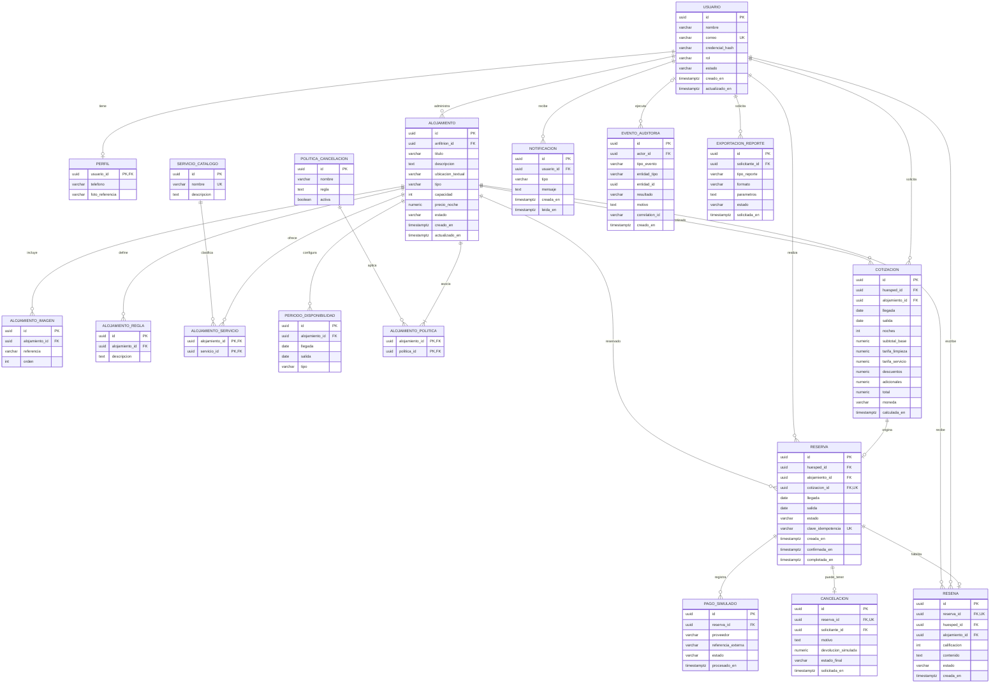

# 8. Modelo lógico de datos

El diagrama propone un modelo relacional conceptual compatible con PostgreSQL. Los nombres finales, tipos y normalización deben validarse frente a los servicios y el diseño físico. `UUID` y `TIMESTAMPTZ` son propuestas técnicas, no restricciones del enunciado.

## Diccionario y restricciones importantes

| Entidad | Responsabilidad | Restricciones propuestas |
|---|---|---|
| USUARIO / PERFIL | Identidad, rol, estado y datos básicos. | Correo único; nunca almacenar contraseña en texto plano; reglas de acceso por rol y propietario. |
| ALOJAMIENTO | Publicación del anfitrión. | `capacidad > 0`; `precio_noche > 0`; propietario obligatorio; estado de enumeración acordada. |
| ALOJAMIENTO_SERVICIO | Relación muchos-a-muchos con catálogo de amenidades. | Clave compuesta alojamiento/servicio. |
| PERIODO_DISPONIBILIDAD | Periodos configurados, bloqueados o reservados. | `llegada < salida`; no permitir conflictos con reservas confirmadas. |
| POLITICA_CANCELACION / ALOJAMIENTO_POLITICA | Define política asociada a la publicación. | El MVP debe aplicar al menos una política. La cardinalidad efectiva y versionado de política se deben decidir. |
| COTIZACION | Congela el desglose consultado por el huésped. | Noches > 0; importes no negativos; total calculado por reglas configuradas; registrar moneda y momento del cálculo. |
| RESERVA | Vincula huésped, alojamiento, periodo y cotización. | Salida > llegada; clave idempotente única dentro del alcance acordado; constraint/control transaccional para solapamientos, no solo consulta previa. |
| PAGO_SIMULADO | Resultado de integración de pruebas. | Solo usar entorno de pruebas; no guardar secretos ni datos de tarjeta. |
| CANCELACION | Evidencia de cancelación y devolución simulada. | Usuario, fecha, motivo, monto simulado y estado final obligatorios según guía. |
| RESENA | Reseña ligada a estancia. | `calificacion` dentro del rango acordado; única por reserva como propuesta; huésped y alojamiento deben coincidir con la reserva y estado completado. |
| EVENTO_AUDITORIA | Historial de cambios/acciones de negocio. | Actor, fecha, entidad, tipo y resultado consultables; no borrar registros para ocultar acciones. |
| EXPORTACION_REPORTE | Auditoría de generación PDF/Excel. | Solicitante/fecha obligatorios; incluir filtros/parámetros y estado de generación. |

## Reglas de integridad que requieren diseño físico

1. **Reserva solapada:** dos intervalos para el mismo alojamiento se solapan si `nueva_llegada < existente_salida AND nueva_salida > existente_llegada` cuando ambos ocupan inventario. La salida se modela excluida si el grupo aprueba esa convención. PostgreSQL puede implementar bloqueo/constraint apropiado; la elección final depende de la estrategia de servicio/transacción.
2. **Idempotencia:** insertar/registrar la clave idempotente en la misma transacción lógica que crea la reserva, con respuesta repetible para reintentos.
3. **Histórico de precio:** la reserva conserva los valores aceptados de la cotización, incluso si el anfitrión cambia después el precio.
4. **Bloqueo de anuncio:** no eliminar reservas futuras al bloquear la publicación; señalarlas para revisión manual.
5. **Auditoría/exportación:** registrar actor y fecha sin exponer secretos o innecesarios datos sensibles.

## Pendientes para completar el modelo físico

- Definir estrategia exacta de intervalos y bloqueos concurrentes.
- Definir moneda y redondeo decimal de importes.
- Definir si la publicación puede tener más de una política/versiones históricas.
- Alinear propiedad de tablas/entidades con límites de servicios para evitar acoplamiento transaccional indebido.
- Derivar migraciones SQL versionadas cuando se acepte el esquema físico.
