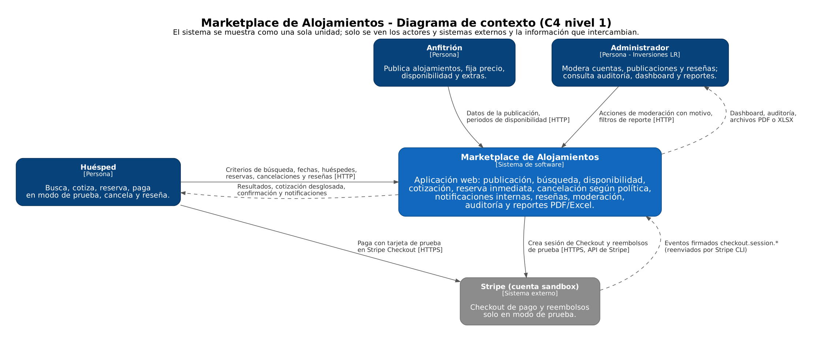
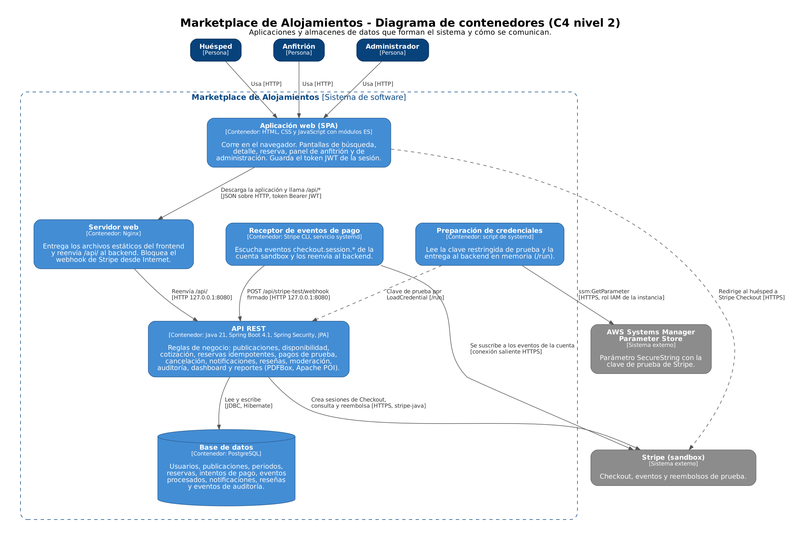
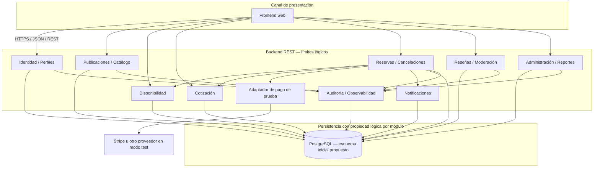
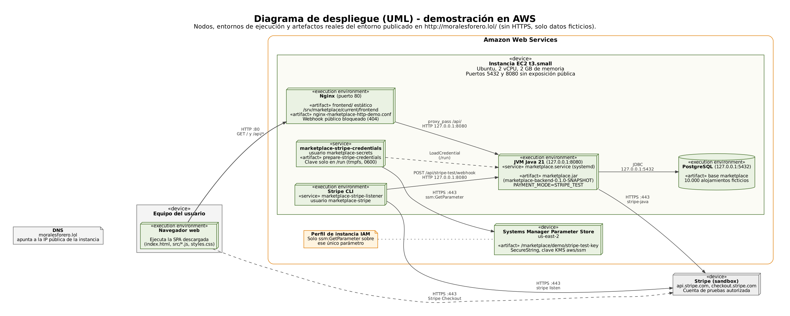
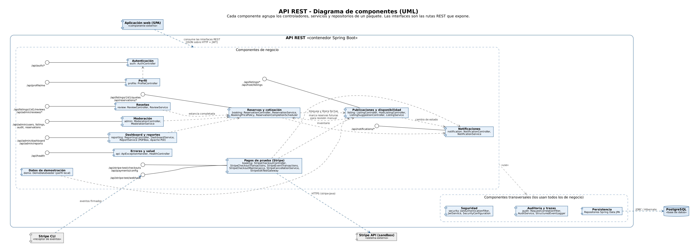

# 9. Diseño orientado a servicios

## 9.1 Criterios de diseño

La guía exige una aplicación web, frontend que consume servicios REST del backend, una arquitectura orientada a servicios, contratos (OpenAPI o equivalente), límites de responsabilidad, interacciones, propiedad de datos e integración con el proveedor de pagos simulado. La siguiente descomposición es una **propuesta lógica para validar**, no una lista prescrita por la guía ni una afirmación de que ya existen microservicios desplegados.

Para un proyecto académico, los límites lógicos pueden implementarse inicialmente en una aplicación Spring Boot modular con controladores/servicios/repositorios; separar procesos en microservicios físicos solo se justifica si los requisitos de despliegue/independencia lo demandan y el equipo puede operarlos.

## 9.2 Diagrama de contexto (C4 nivel 1)

El sistema se representa como una sola unidad. Alrededor están los actores y sistemas externos y la información que intercambian con él. Los datos salen del código integrado en `main`: controladores REST, `StripeSdkTestGateway` y la configuración de `deploy/ec2/stripe`.

Fuente: [diagramas/fuentes/09-c4-contexto.dot](diagramas/fuentes/09-c4-contexto.dot).

| Elemento externo | Envía al sistema | Recibe del sistema |
|---|---|---|
| Huésped | Criterios de búsqueda, fechas, huéspedes, solicitud de reserva, motivo de cancelación y reseñas. | Resultados, cotización desglosada, confirmación de la reserva y notificaciones internas. |
| Anfitrión | Datos de la publicación, precio, extras, política de cancelación y periodos de disponibilidad. | Estado de sus publicaciones, reservas recibidas y notificaciones. |
| Administrador | Acciones de moderación con motivo y filtros de reporte. | Dashboard, eventos de auditoría y archivos PDF o XLSX. |
| Stripe (sandbox) | Eventos firmados `checkout.session.*`. | Solicitudes para crear sesiones de Checkout y reembolsos de prueba. |

La recuperación de contraseña es simulada: no hay proveedor de correo. Por eso no aparece como sistema externo.

### Diagrama de contenedores (C4 nivel 2)

Fuente: [diagramas/fuentes/09-c4-contenedores.dot](diagramas/fuentes/09-c4-contenedores.dot).

| Contenedor | Tecnología | Responsabilidad |
|---|---|---|
| Aplicación web (SPA) | HTML, CSS y JavaScript con módulos ES, sin framework (`frontend/`) | Pantallas de huésped, anfitrión y administrador; guarda el token JWT y consume la API. |
| Servidor web | Nginx | Entrega los archivos estáticos y reenvía `/api/` al backend; bloquea el webhook público. |
| API REST | Java 21, Spring Boot 4.1, Spring Security, Spring Data JPA, PDFBox, Apache POI, stripe-java | Reglas de negocio, seguridad, auditoría, reportes y pagos de prueba. |
| Base de datos | PostgreSQL | Persistencia de todas las entidades (ver [modelo físico](08-modelo-datos.md)). |
| Receptor de eventos de pago | Stripe CLI como servicio systemd | Recibe los eventos de la cuenta sandbox y los reenvía a `127.0.0.1:8080/api/stripe-test/webhook`. |
| Preparación de credenciales | Script de systemd | Lee la clave restringida de AWS Systems Manager y la entrega al backend en `/run`. |

## 9.3 Límites lógicos propuestos

| Servicio lógico | Responsabilidad y datos bajo su autoridad | APIs/capacidades | Requisitos/épicas |
|---|---|---|---|
| Identidad y perfiles | Usuarios, roles, sesiones, perfil y estado de cuenta. | Registro, login, recuperación simulada, perfil, activación de cuenta. | RF-001–003 · EP-01 |
| Publicaciones/Catálogo | Publicaciones, anfitrión dueño, servicios, reglas, imágenes y estado. | CRUD de anuncios, activar/pausar, detalle, búsqueda por características. | RF-004–006, RF-008–009 · EP-02/04 |
| Disponibilidad | Periodos disponibles, bloqueados y relacionados con reservas. | Consulta de disponibilidad, mantenimiento de periodos, bloqueo/liberación. | RF-007, reglas de solapamiento · EP-03 |
| Cotización | Componentes de precio, fórmulas configurables y snapshot de cotización. | Cotizar por fechas/personas/extras, explicar desglose, validar vigencia. | RF-010, RN-009 · EP-05 |
| Reservas y cancelaciones | Reservas, estados, clave idempotente y cancelaciones/devoluciones simuladas. | Crear reserva, consultar historial/estado, confirmar, cancelar. | RF-011–013 · EP-05/06 |
| Pagos de prueba | Referencias y resultados del proveedor sandbox/test. | Crear/consultar intento simulado, mapear éxito/fallo técnico. | RF-012, RN-016 · EP-05 |
| Notificaciones | Mensajes internos asociados a eventos y destinatarios. | Registrar/listar/marcar leídas según diseño final. | RF-014 · EP-07 |
| Reseñas y moderación | Reseñas, estado de moderación y vínculos de reserva. | Crear reseña permitida, consultar reseñas, ocultar moderadamente. | RF-015–016 · EP-08/09 |
| Administración/Reportes | Acciones administrativas, consulta de auditoría, métricas y solicitudes de exportación. | Bloquear/restringir, dashboard, PDF/Excel y registro de solicitante/fecha. | RF-017–019 · EP-09 |
| Observabilidad | Convenciones de evento, correlación y logs no sensibles. | Publicar/consultar auditoría/logs según permisos. | RF-020, RNF-004 · EP-10 |

## 9.4 Diagrama lógico de solución

La persistencia única dibujada facilita el primer despliegue académico; el ownership de los datos sigue siendo lógico por módulo. Si se decide separación física más adelante, deben revisarse transacciones, consistencia y límites de integración.

## 9.5 Interacciones críticas

### Reserva inmediata

1. Frontend solicita disponibilidad y cotización; el resultado es informativo.
2. Al confirmar, Reservas revalida publicación activa, fechas, precio/snapshot y disponibilidad dentro de una operación consistente.
3. Se asegura idempotencia para la misma solicitud lógica.
4. Se realiza el flujo de pago de prueba según un contrato/adaptador y los estados aprobados.
5. Solo al cumplir la política acordada, la reserva se confirma y el calendario se bloquea.
6. Se persisten eventos de auditoría y notificaciones. Fallo/reintento debe ser recuperable sin duplicar reserva.

### Cancelación

1. Reservas valida titularidad y estado.
2. Consulta la política asociada al anuncio y calcula devolución simulada.
3. Actualiza cancelación/estado y libera disponibilidad solo si la regla lo indica.
4. Audita y notifica la operación.

### Bloqueo administrativo

1. Administración valida rol y motivo.
2. Publicaciones cambia estado a BLOQUEADA y crea evento auditable.
3. Reservas futuras quedan conservadas y marcadas para revisión manual según la guía; no se cancelan o eliminan automáticamente.

## 9.6 Contratos, seguridad y errores

- JSON y REST sobre HTTPS en entornos desplegados; OpenAPI inicial en `10-openapi.yaml`.
- Validación sintáctica y de negocio en backend; control de propietario y rol en servidor.
- Respuestas de error con código HTTP apropiado, `code`, mensaje comprensible y `correlationId` sin filtrar información interna.
- Secretos por variables de entorno/Actions Secrets; nunca versionados.
- Integración de pagos exclusivamente con claves/objetos de prueba. No recibir ni almacenar datos de tarjetas.
- Cambios de estado y seguridad trazables, logs estructurados sin contraseñas/tokens.

## 9.7 Mapeo requerimiento–servicio

La matriz completa debe mantenerse en Jira/Confluence y `docs/TRACEABILITY_TEMPLATE.csv`. Como mínimo, cada servicio lógico se relaciona con sus RF/ RN, procesos PB, historias HU, contrato API, propietario lógico de los datos y pruebas end-to-end. Antes de implementación, el equipo debe acordar si los servicios son módulos del mismo backend o despliegues independientes.

## 9.8 Diagrama de despliegue

Esta vista reemplaza la propuesta inicial, que dejaba el proveedor sin seleccionar. Representa el entorno publicado en [moralesforero.lol](http://moralesforero.lol/): una instancia EC2 `t3.small` (Ubuntu, 2 vCPU, 2 GB) con Nginx, la aplicación Java y PostgreSQL en la misma máquina, más los servicios de Stripe sandbox. Los datos salen de [DESPLIEGUE-EC2.md](../DESPLIEGUE-EC2.md), [deploy/ec2](../../deploy/ec2/), [STRIPE-PRUEBAS.md](../STRIPE-PRUEBAS.md) y [EVIDENCIA-ENTREGA-FINAL.md](../EVIDENCIA-ENTREGA-FINAL.md).

Fuente: [diagramas/fuentes/09-despliegue.dot](diagramas/fuentes/09-despliegue.dot).

| Nodo | Artefactos y entornos | Comunicación |
|---|---|---|
| Equipo del usuario | Navegador con la SPA | HTTP al puerto 80 de la instancia; HTTPS a Stripe Checkout. |
| Instancia EC2 | Nginx con `frontend/`; JVM con `marketplace.jar` (`marketplace.service`); PostgreSQL local; Stripe CLI (`marketplace-stripe-listener`); `marketplace-stripe-credentials` | Nginx a la JVM por `127.0.0.1:8080`; JVM a PostgreSQL por `127.0.0.1:5432`. Los puertos 8080 y 5432 no se publican. |
| Systems Manager Parameter Store (us-east-2) | Parámetro SecureString `/marketplace/demo/stripe-test-key` | Lectura con `ssm:GetParameter` mediante el perfil IAM de la instancia. |
| Stripe sandbox | API, Checkout y eventos de la cuenta de pruebas | HTTPS saliente desde la JVM y desde Stripe CLI. |

Limitaciones conocidas: el sitio usa HTTP sin cifrado y solo admite datos ficticios; base, aplicación y servidor web comparten un único nodo, por lo que la instancia es un punto único de falla. La publicación de versiones es manual (ver [pipeline CI/CD](20-diseno-detallado.md#204-pipeline-cicd)).

## 9.9 Diagrama de componentes de la API

Cada componente agrupa los controladores, servicios y repositorios de un paquete del backend. Los círculos son las interfaces provistas, es decir, las rutas REST reales. Las flechas discontinuas son dependencias de uso obtenidas de los `import` del código.

Fuente: [diagramas/fuentes/09-componentes.dot](diagramas/fuentes/09-componentes.dot).

Los límites lógicos de la sección 9.3 se implementaron como módulos de una sola aplicación Spring Boot, no como microservicios desplegados por separado. La relación entre paquetes y sus dependencias circulares se documenta en el [diagrama de paquetes](20-diseno-detallado.md#201-diagrama-de-paquetes).
