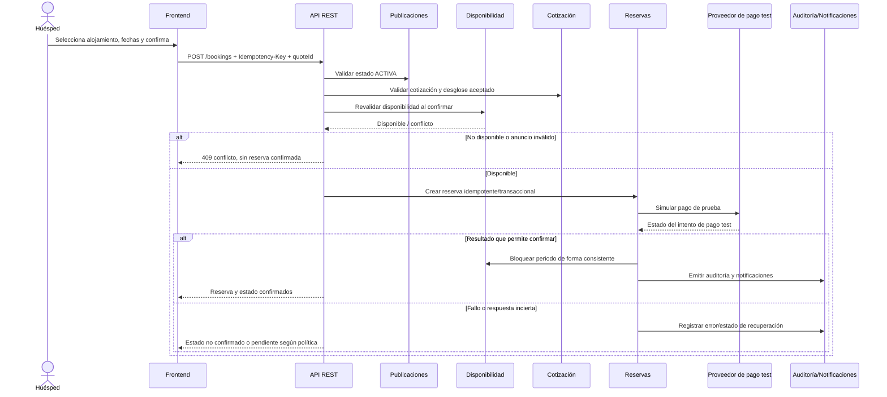
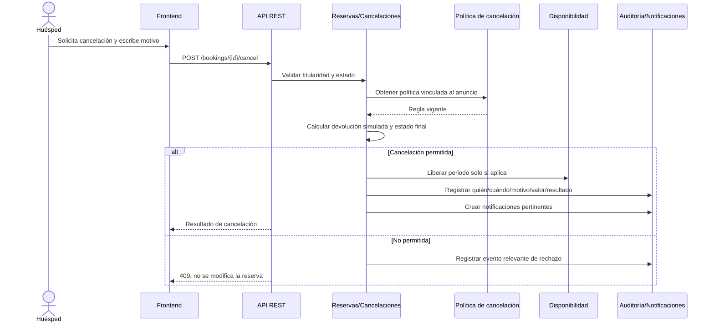
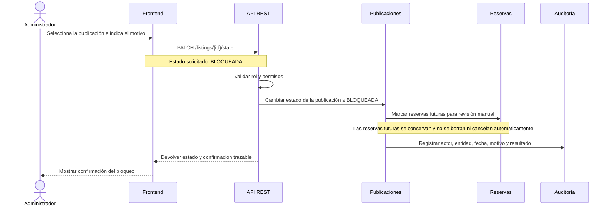
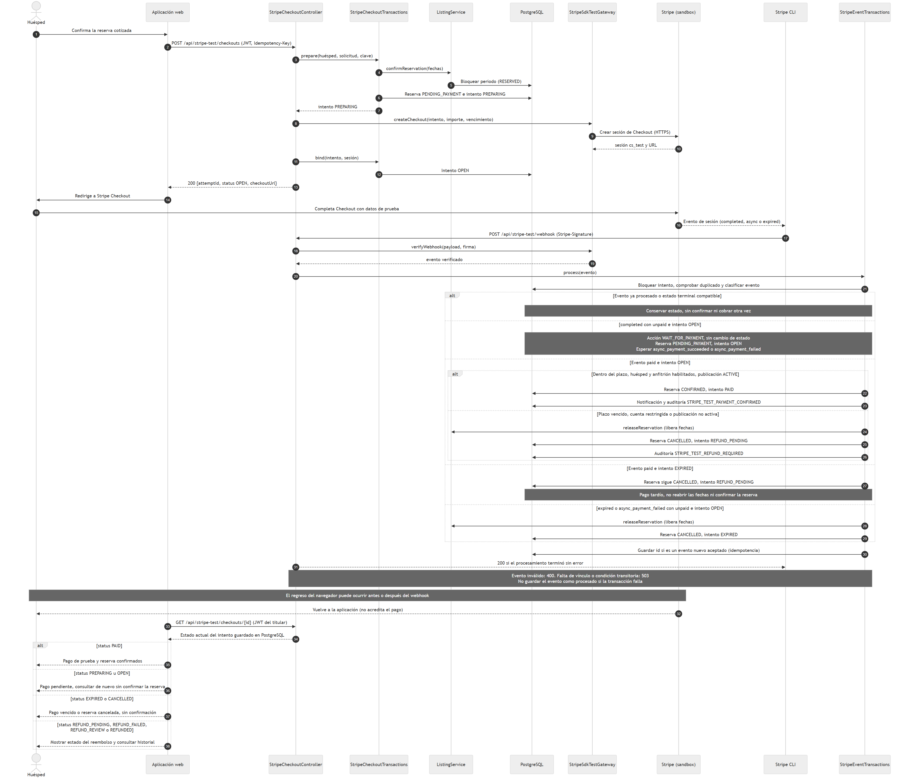
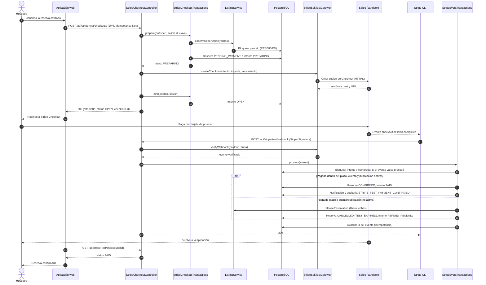

# 14. Diagramas de secuencia

SD-01 a SD-03 representan interacciones de diseño propuestas en la Entrega 1 para escenarios críticos de la guía. SD-04 describe el flujo de pago implementado en `main`.

## SD-01 — Confirmar una reserva

**Controles importantes:** no confiar solo en disponibilidad consultada durante búsqueda; validar en el punto de confirmación. La clave idempotente se guarda bajo una restricción de unicidad para evitar duplicados. La estrategia de compensación frente a fallo del proveedor debe quedar especificada por el equipo.

## SD-02 — Cancelar una reserva

## SD-03 — Bloquear publicación por administrador

## SD-04: Reservar y pagar con Stripe en modo de prueba (implementado)

A diferencia de SD-01 a SD-03, que son de diseño, este diagrama sale del código en `main`: `StripeCheckoutController`, `StripeCheckoutTransactions`, `StripeEventTransactions`, `StripeCheckoutEventDecision` y `StripeSdkTestGateway`. Aplica cuando `PAYMENT_MODE=STRIPE_TEST`, que es el modo del entorno publicado.

Notas:

- La reserva y el bloqueo de fechas ocurren antes de ir a Stripe, en una sola transacción; así nadie más puede reservar esas fechas mientras el huésped paga.
- Las llamadas a Stripe se hacen fuera de los bloqueos de base de datos.
- Si el evento llega antes de que se guarde la sesión, el backend responde con reintento; si se pierde la respuesta de creación, recupera la sesión por su id firmado.
- `StripeCheckoutMaintenance` revisa cada minuto los intentos abiertos y vence los que pasaron su plazo.

## Criterios de consistencia de los diagramas

- Cada operación de escritura debe validar rol y dueño del recurso en el backend.
- Las transacciones deben conservar un solo resultado válido ante reintentos.
- Los cambios relevantes actualizan auditoría; las notificaciones no deben reemplazar el registro de negocio.
- Los códigos y estructuras de respuesta deben concordar con `10-openapi.yaml` cuando se implemente el contrato.
