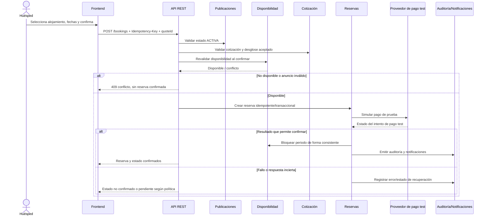
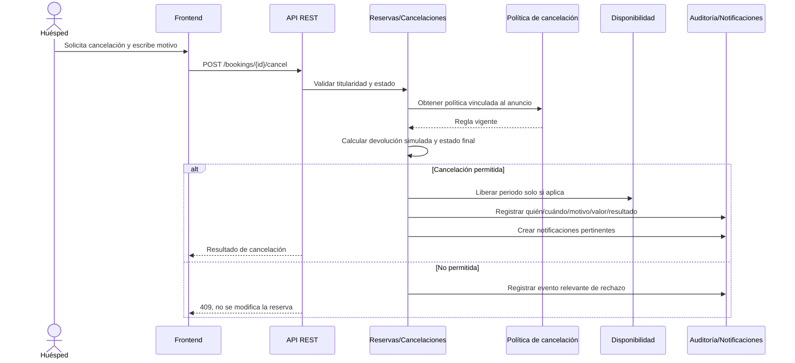
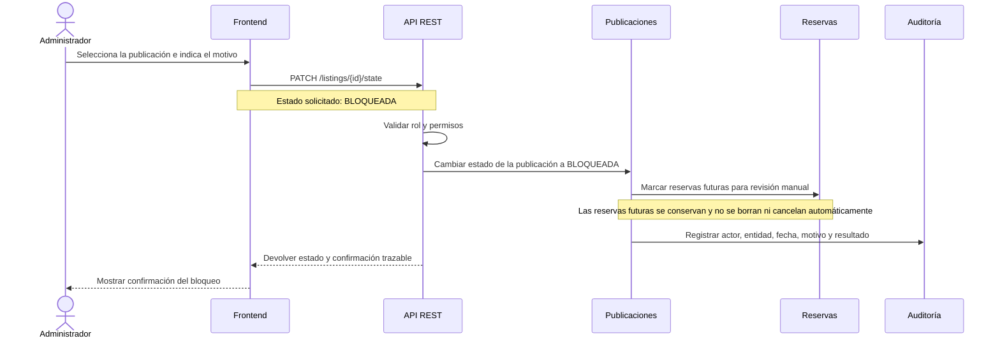

# 14. Diagramas de secuencia

Los diagramas representan interacciones de diseño propuestas para escenarios críticos de la guía. Son contratos de comportamiento por validar; no demuestran implementación existente.

## SD-01 — Confirmar una reserva

**Controles importantes:** no confiar solo en disponibilidad consultada durante búsqueda; validar en el punto de confirmación. La clave idempotente se guarda bajo una restricción de unicidad para evitar duplicados. La estrategia de compensación frente a fallo del proveedor debe quedar especificada por el equipo.

## SD-02 — Cancelar una reserva

## SD-03 — Bloquear publicación por administrador

## Criterios de consistencia de los diagramas

- Cada operación de escritura debe validar rol y dueño del recurso en el backend.
- Las transacciones deben conservar un solo resultado válido ante reintentos.
- Los cambios relevantes actualizan auditoría; las notificaciones no deben reemplazar el registro de negocio.
- Los códigos y estructuras de respuesta deben concordar con `10-openapi.yaml` cuando se implemente el contrato.
