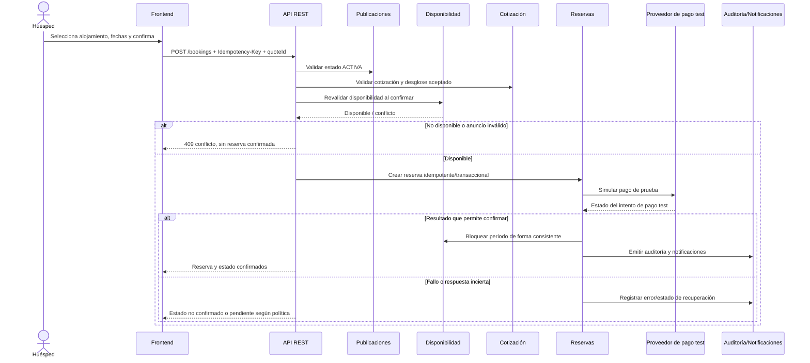
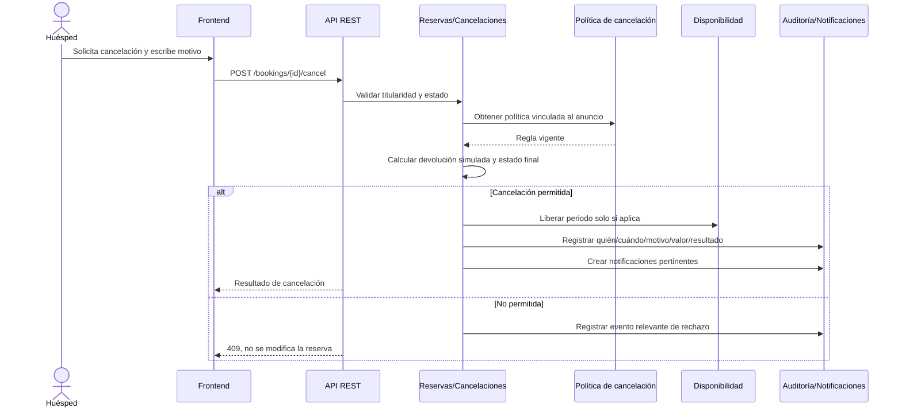
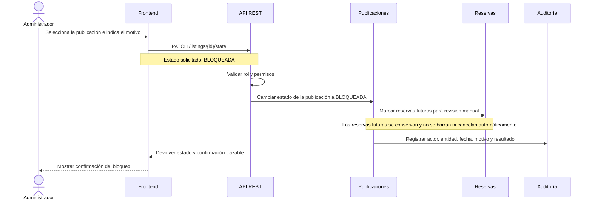
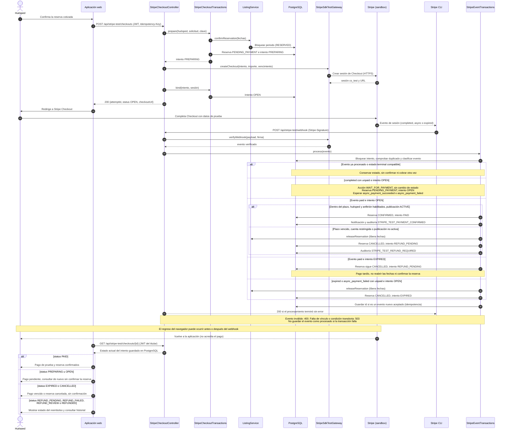

# 14. Diagramas de secuencia

SD-01 a SD-03 conservan el diseño histórico de la Entrega 1 para escenarios críticos de la guía; sus rutas y pasos conceptuales no sustituyen el contrato de la implementación actual. SD-04 describe el flujo de pago implementado en `main`.

## SD-01 — Confirmar una reserva

**Controles importantes:** no confiar solo en disponibilidad consultada durante búsqueda; validar en el punto de confirmación. La clave idempotente se guarda bajo una restricción de unicidad para evitar duplicados. La estrategia de compensación frente a fallo del proveedor debe quedar especificada por el equipo.

## SD-02 — Cancelar una reserva

## SD-03 — Bloquear publicación por administrador

## SD-04: Reservar y pagar con Stripe en modo de prueba (implementado)

A diferencia de SD-01 a SD-03, que son de diseño histórico, este diagrama sale del código en `main`: `StripeCheckoutController`, `StripeCheckoutTransactions`, `StripeEventTransactions`, `StripeCheckoutEventDecision`, `StripeSdkTestGateway` y `frontend/src/stripe-checkout.js`. Aplica cuando `PAYMENT_MODE=STRIPE_TEST`, que es el modo del entorno publicado. La creación de sesión muestra el caso inicial correcto; el procesamiento distingue eventos pagados, pendientes, vencidos y repetidos.

Notas:

- La reserva y el bloqueo de fechas ocurren antes de ir a Stripe, en una sola transacción; así nadie más puede reservar esas fechas mientras el huésped paga.
- Las llamadas a Stripe se hacen fuera de los bloqueos de base de datos.
- Si falta el vínculo con la sesión, el controlador intenta recuperarla mediante el id del evento firmado y la verifica con Stripe. Si el intento aún no puede procesarse, responde `503` para reintento sin confiar en una sesión no vinculada.
- Los eventos admitidos son `checkout.session.completed`, `checkout.session.async_payment_succeeded`, `checkout.session.async_payment_failed` y `checkout.session.expired`. `completed` con `payment_status=unpaid` produce la **acción** `WAIT_FOR_PAYMENT`: no es un estado nuevo de la base de datos; el intento sigue `OPEN` y la reserva sigue `PENDING_PAYMENT` hasta otro evento o el vencimiento.
- Solo un evento `paid` válido sobre un intento `OPEN`, con plazo vigente, reserva `PENDING_PAYMENT`, huésped y anfitrión habilitados y sin restricción, y publicación `ACTIVE`, puede dejar el intento `PAID` y la reserva `CONFIRMED`. Si falla esa validación de vigencia, se liberan las fechas, la reserva queda `CANCELLED` y el intento `REFUND_PENDING`. Un pago tardío sobre `EXPIRED` también solicita reembolso sin confirmar ni recuperar las fechas.
- Los eventos repetidos y los ya compatibles con un estado terminal no confirman de nuevo. El id del evento nuevo se guarda en la misma transacción que sus efectos; un error no se marca como procesado. Un evento inválido se rechaza y una condición transitoria devuelve `503` para reintento.
- El retorno desde Stripe puede preceder al webhook. La web consulta con la cuenta titular el estado guardado por el servidor; solo `PAID` presenta confirmación. `PREPARING`/`OPEN`, `EXPIRED`/`CANCELLED` y los estados de reembolso muestran mensajes distintos, sin convertirlos en una reserva confirmada por el mero regreso del navegador.
- `StripeCheckoutMaintenance` revisa cada minuto los intentos abiertos y vence los que pasaron su plazo; también concilia los reembolsos pendientes. Su resultado se refleja como `REFUNDED`, `REFUND_FAILED` o `REFUND_REVIEW`, según la respuesta o la incertidumbre del proveedor. No se presenta un reembolso pendiente como ejecutado.

## Criterios de consistencia de los diagramas

- Cada operación de escritura debe validar rol y dueño del recurso en el backend.
- Las transacciones deben conservar un solo resultado válido ante reintentos.
- Los cambios relevantes actualizan auditoría; las notificaciones no deben reemplazar el registro de negocio.
- SD-01 a SD-03 conservan el contrato propuesto en `10-openapi.yaml`; para las rutas y respuestas vigentes de SD-04 se consulta [el contrato implementado](../openapi.yaml) y [la referencia de la API actual](../API-IMPLEMENTADA.md).
