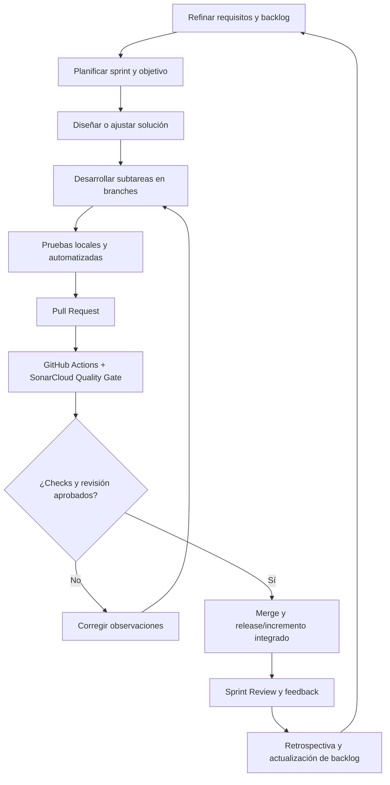

# 16. Ciclo de vida del software

## 16.1 Modelo seleccionado

**Modelo de ciclo de vida propuesto: iterativo e incremental, aplicado junto con Scrum.** La guía del curso propone fases desde la planeación, ingeniería de requerimientos y diseño orientado a servicios hasta la implementación incremental, integración continua, validación y cierre. Un ciclo iterativo-incremental permite revisar y refinar requerimientos, diseñar, construir y verificar partes del MVP, incorporando feedback en iteraciones sucesivas.

Scrum organiza el trabajo del equipo (roles, backlog, sprints, eventos y artefactos); el ciclo de vida describe cómo evoluciona el software desde la idea inicial hasta su operación y mantenimiento. Son conceptos relacionados, pero no equivalentes. Esta selección es coherente con la entrega incremental descrita en la guía y debe ser ratificada por el equipo en Jira/Confluence.

## 16.2 Fases del ciclo de vida en el proyecto

| Fase | Propósito | Actividades principales | Artefactos/evidencia | Criterio de salida |
|---|---|---|---|---|
| CL-01. Inicio y planeación | Alinear problema, valor, interesados, alcance y forma de trabajo. | Comprender contexto, definir visión/alcance, identificar actores, acordar metodología/roles, riesgos, calendario inicial y herramientas. | Visión, RBN, actores/interesados, WBS, riesgos, decisiones y backlog inicial. | Alcance del MVP y forma de trabajo revisados por el equipo; preguntas críticas identificadas. |
| CL-02. Ingeniería y análisis de requerimientos | Transformar la necesidad del negocio en una especificación verificable. | Elicitar, analizar contradicciones, priorizar el MVP, identificar RN/RF/RNF, crear épicas e historias con criterios y dependencias, validar con interesados. | Catálogo RF/RNF/RN/RBN, historias de Jira, criterios Dado/Cuando/Entonces, casos de prueba diseñados y matriz de trazabilidad. | Historias Ready con criterios claros y decisiones críticas resueltas o documentadas. |
| CL-03. Diseño de solución | Definir cómo los componentes satisfacen los requisitos. | Modelar procesos/BPMN, casos de uso, dominio, datos, límites de servicio, contratos REST/OpenAPI, secuencias, seguridad, despliegue y observabilidad. | BPMN, casos de uso, modelo de dominio/datos, diagramas de contexto/servicios/secuencia, OpenAPI y decisiones ADR. | Diseño consistente con el backlog y revisado; riesgos técnicos principales tratados. |
| CL-04. Planificación de incremento | Seleccionar un conjunto alcanzable de historias y tareas para una iteración. | Refinar/priorizar backlog, estimar, verificar dependencias, asignar responsable, preparar subtareas y objetivo de sprint. | Sprint en Jira, historias/tareas vinculadas, story points, responsables, sprint goal y Definition of Done. | El equipo conoce el objetivo, alcance comprometido y forma de validación del sprint. |
| CL-05. Implementación incremental | Construir el incremento con cambios pequeños y trazables. | Crear branch desde `develop`, desarrollar tareas, actualizar contratos/documentación y añadir pruebas unitarias/integración. | Código, commits coherentes, subtareas enlazadas a historias Jira, tests y actualización de trazabilidad. | La funcionalidad satisface los criterios en ambiente local y está lista para PR. |
| CL-06. Integración y verificación | Prevenir regresiones y mantener estable la línea principal. | Abrir PR, ejecutar GitHub Actions, pruebas automáticas, análisis SonarCloud/Quality Gate, revisión por otro integrante, corregir observaciones. | PR, checks, reportes de prueba, estado Quality Gate, comentarios/resoluciones de revisión. | Checks obligatorios exitosos y al menos una revisión humana independiente antes de merge. |
| CL-07. Validación de incremento y entrega | Confirmar valor, comparar con objetivo y obtener feedback. | Demostrar historias, ejecutar pruebas de aceptación, revisar fallos/limitaciones, actualizar backlog y trazar versión. | Sprint Review, evidencia de casos CP, feedback real, release/notas y matriz de trazabilidad. | Incremento aceptado o historias no aceptadas devueltas al backlog con motivo. |
| CL-08. Despliegue y transición | Entregar un incremento reproducible a un ambiente de prueba/entrega. | Construir artefactos, aplicar configuración segura, migraciones de datos, preparar manual y comprobar smoke tests. | Manual de despliegue, configuración por ambiente sin secretos versionados, release y evidencia del despliegue. | Aplicación disponible y verificaciones de humo aprobadas en el entorno objetivo. |
| CL-09. Operación, mantenimiento y evolución | Mantener el producto, corregir fallos y adaptar reglas/capacidades. | Observar logs, atender defectos, revisar métricas, priorizar cambios, actualizar requerimientos/modelos/pruebas y preparar el siguiente incremento. | Issues de defectos, logs/auditoría, cambios de ADR, nueva versión y lecciones aprendidas. | Incidentes tratados, cambios trazados y siguiente ciclo priorizado. |

## 16.3 Ciclo que se repite por sprint

El diagrama representa el proceso objetivo. Hasta que SonarCloud esté configurado y exista evidencia de despliegue/operación, esas actividades se consideran previstas, no ejecutadas completamente.

## 16.4 Entregas del curso y ciclo de vida

- **Entrega 1 — Análisis y diseño:** CL-01 a CL-04 se documentan/validan parcialmente; se prepara especificación, diseño, backlog inicial, plan de pruebas y ciclo de vida. Los modelos requieren validación del equipo y publicación/enlace en Confluence.
- **Entrega 2 — Producto funcional, pruebas e integración continua:** profundiza CL-04 a CL-09 mediante implementación de las capacidades obligatorias, pruebas reales, CI/CD requerido por el curso, SonarCloud, despliegue verificable, releases y trazabilidad del producto entregado.

## 16.5 Criterios de calidad transversales

1. Ningún cambio se considera terminado solo por compilar: debe satisfacer sus criterios de aceptación y pruebas aplicables.
2. La seguridad y la validación de permisos se prueban en backend, no solo en frontend.
3. Reservas requieren consistencia ante concurrencia e idempotencia; los pagos se simulan exclusivamente en modo de pruebas.
4. Las decisiones de cambio deben actualizar requerimientos, procesos, historias, modelos, API, pruebas y trazabilidad.
5. La aprobación de PR y el feedback deben ser reales; no se generan aprobaciones, capturas o resultados ficticios para completar la evidencia.
