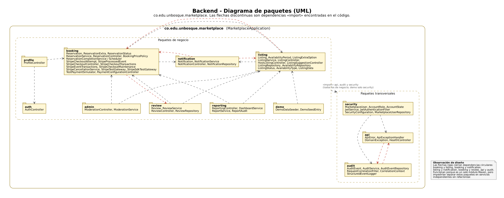
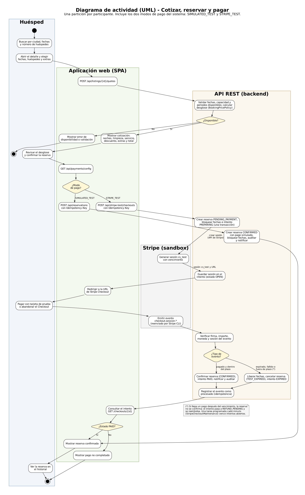
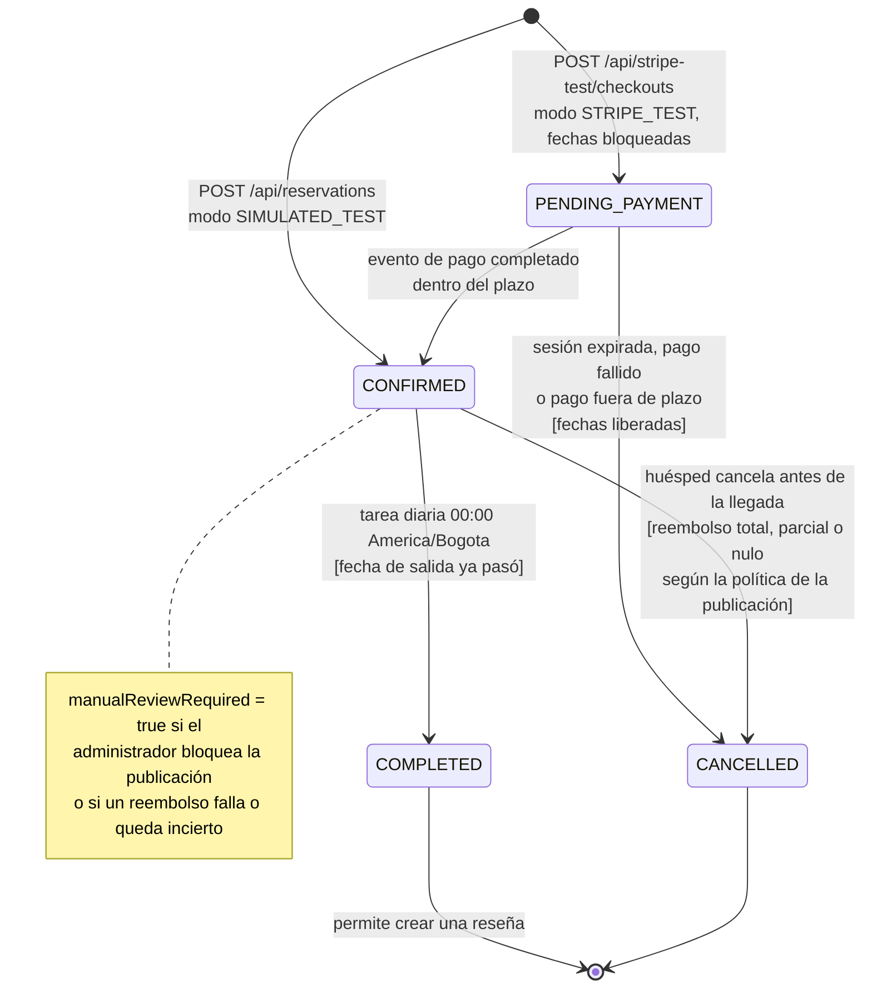
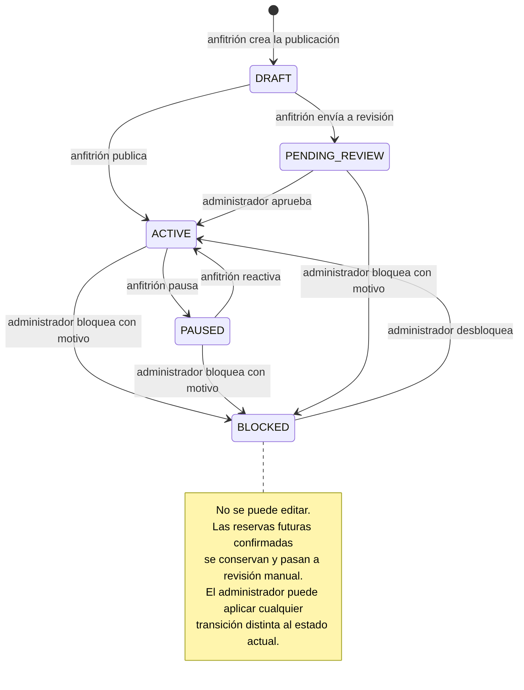
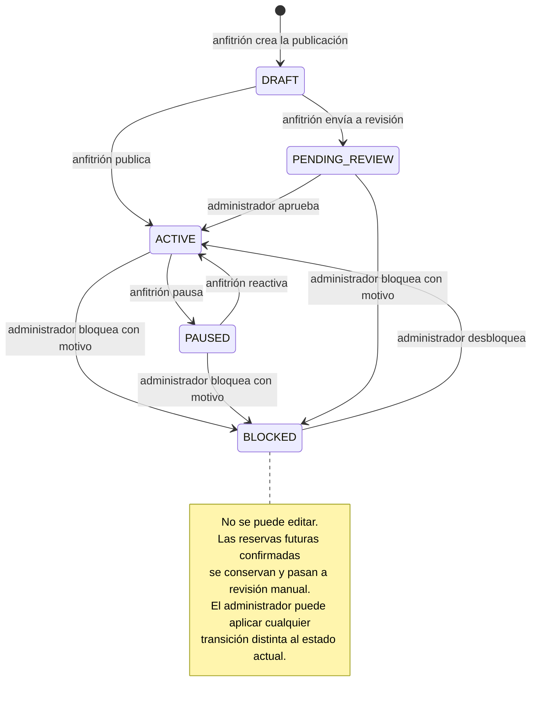
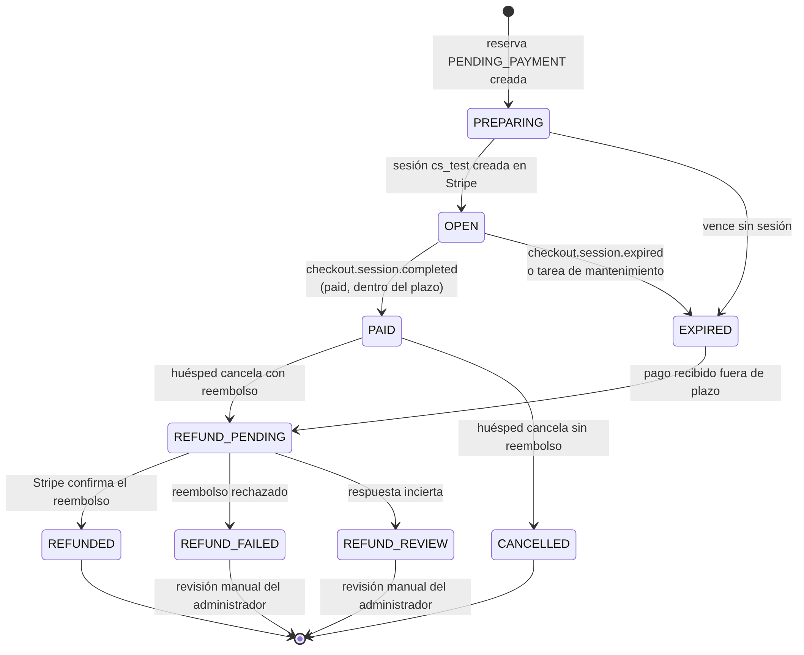
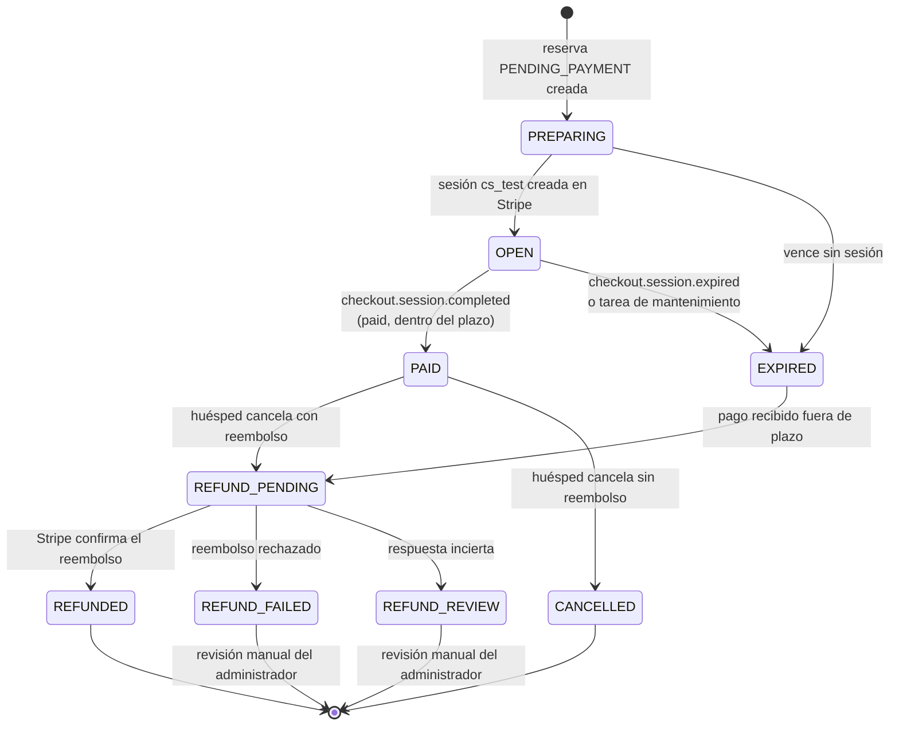
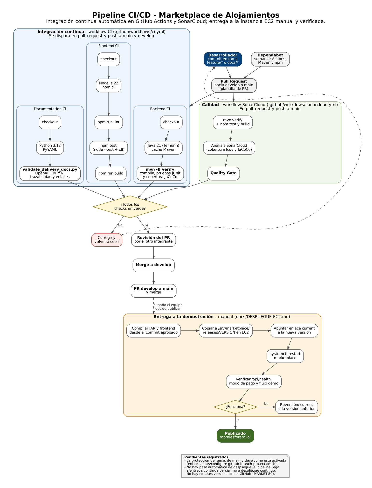

# 20. Diseño detallado: paquetes, actividad, estados y pipeline

Diagramas del ciclo de diseño que pide la clase (paquetes, actividad, máquina de estados y pipeline CI/CD). Todos salen del código y la configuración integrados en `main`; cada uno indica su fuente para poder comprobarlo. Los diagramas de contexto, contenedores, componentes y despliegue están en [09. Arquitectura](09-arquitectura-servicios.md); el modelo físico de datos, en [08. Modelo de datos](08-modelo-datos.md); la secuencia del pago con Stripe, en [14. Secuencias](14-secuencias.md).

## 20.1 Diagrama de paquetes

Paquetes Java bajo `co.edu.unbosque.marketplace` con las clases que contiene cada uno. Las flechas son dependencias `import` reales entre paquetes.

Fuente: [diagramas/fuentes/20-paquetes.dot](diagramas/fuentes/20-paquetes.dot).

| Paquete | Responsabilidad | Depende de |
|---|---|---|
| `api` | Errores comunes, excepción de dominio y salud | `audit` |
| `security` | Usuario, roles, estados de cuenta, JWT y configuración de Spring Security | `api`, `audit` |
| `audit` | Eventos de auditoría, correlación de peticiones y logs estructurados | `api` |
| `auth` | Registro, inicio de sesión y recuperación simulada | `api`, `audit`, `security` |
| `profile` | Perfil del usuario autenticado | `api`, `audit`, `auth`, `booking`, `security` |
| `listing` | Publicaciones, disponibilidad, sugerencias de destino | `api`, `audit`, `booking`, `notification`, `security` |
| `booking` | Cotización, reservas, cancelación, pagos simulados y Stripe sandbox | `api`, `audit`, `listing`, `notification`, `review`, `security` |
| `notification` | Notificaciones internas | `api`, `booking`, `listing`, `security` |
| `review` | Reseñas y su moderación | `api`, `audit`, `booking`, `listing`, `security` |
| `admin` | Moderación de cuentas, auditoría y revisión manual | `api`, `audit`, `booking`, `listing`, `security` |
| `reporting` | Dashboard y exportación PDF/XLSX | `api`, `audit`, `booking`, `listing`, `security` |
| `demo` | Carga de datos de demostración | `listing`, `security` |

Observación: hay dependencias circulares entre `booking` y `listing`, `booking` y `notification`, `listing` y `notification`, `booking` y `review`, y `api` y `audit`. No afectan el funcionamiento porque todo es un solo módulo Maven, pero impedirían separar esos paquetes en servicios independientes sin refactorizar.

## 20.2 Diagrama de actividad

Flujo de cotizar, reservar y pagar, con una partición por participante. Cubre los dos modos de pago del sistema: `SIMULATED_TEST` (reserva confirmada al instante con pago simulado) y `STRIPE_TEST` (pago en Stripe sandbox, modo del entorno publicado).

Fuente: [diagramas/fuentes/20-actividad-reserva.dot](diagramas/fuentes/20-actividad-reserva.dot). Clases: `ReservationService`, `BookingPricePolicy`, `StripeCheckoutTransactions`, `StripeEventTransactions`, `StripeCheckoutEventDecision`; en el frontend, `booking.js` y `stripe-checkout.js`.

## 20.3 Diagramas de máquina de estados

### Reserva (`ReservationStatus`)

Fuente: métodos de `Reservation`, `ReservationService.cancel`, `StripeEventTransactions` y la consulta `completeBefore` de `ReservationRepository`, que ejecuta `ReservationCompletionScheduler` cada día a las 00:00 (America/Bogota). Solo se puede cancelar una reserva `CONFIRMED` cuya estancia no haya empezado; solo una reserva `COMPLETED` admite reseña.

### Publicación (`ListingStatus`)

Fuente: `ListingService.changeState`. El anfitrión solo puede hacer las transiciones `DRAFT` a `ACTIVE` o `PENDING_REVIEW`, `ACTIVE` a `PAUSED` y `PAUSED` a `ACTIVE`. El administrador puede aplicar cualquier transición distinta al estado actual y es el único que puede bloquear, siempre con motivo. Al bloquear, las reservas futuras confirmadas se marcan para revisión manual.

### Intento de pago con Stripe (`StripeCheckoutAttempt.State`)

Fuente: métodos `opened`, `paid`, `expired`, `requireRefund`, `refunded`, `refundFailed`, `refundNeedsReview` y `cancelledWithoutRefund` de `StripeCheckoutAttempt`. Los estados `REFUND_FAILED` y `REFUND_REVIEW` marcan la reserva para revisión manual del administrador.

## 20.4 Pipeline CI/CD

Fuente: [diagramas/fuentes/20-pipeline-ci-cd.dot](diagramas/fuentes/20-pipeline-ci-cd.dot), a partir de [ci.yml](../../.github/workflows/ci.yml), [sonarcloud.yml](../../.github/workflows/sonarcloud.yml), [dependabot.yml](../../.github/dependabot.yml) y [DESPLIEGUE-EC2.md](../DESPLIEGUE-EC2.md).

| Etapa | Herramienta | Qué hace | Automática |
|---|---|---|---|
| Control de versiones | Git y GitHub | Ramas `feature/*` y `docs/*`, PR hacia `develop` y de `develop` a `main` | Sí |
| Actualización de dependencias | Dependabot | PR semanales para GitHub Actions, Maven y npm | Sí |
| Build y pruebas del backend | GitHub Actions (Backend CI) | `mvn -B -ntp -f backend/pom.xml verify` con JUnit y JaCoCo | Sí |
| Build y pruebas del frontend | GitHub Actions (Frontend CI) | `npm ci`, `npm run lint`, `npm test` con c8 y `npm run build` | Sí |
| Validación documental | GitHub Actions (Documentation CI) | `scripts/validate_delivery_docs.py`: OpenAPI, BPMN, trazabilidad y enlaces | Sí |
| Calidad | SonarCloud | Análisis estático y Quality Gate en PR y en `main` | Sí |
| Revisión | GitHub | Revisión del PR por el otro integrante | Manual |
| Entrega a la demostración | EC2 | Copiar JAR y frontend a una carpeta de versión, cambiar el enlace `current`, reiniciar y verificar | Manual |
| Reversión | EC2 | Volver a apuntar `current` a la versión anterior | Manual |

El proyecto tiene integración continua completa y entrega manual: no hay despliegue continuo. Pendientes registrados: activar la protección de ramas (existe [configure-github-branch-protection.sh](../../scripts/configure-github-branch-protection.sh)) y publicar releases versionados (MARKET-80).
