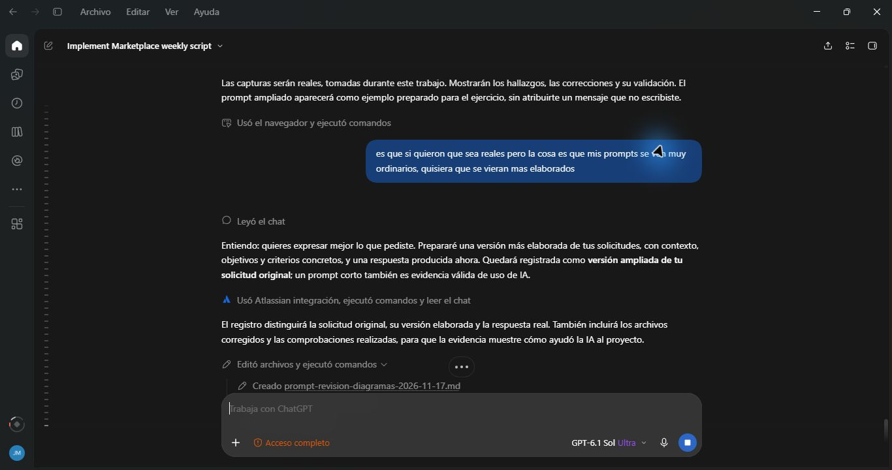

# Uso real de IA — revisión de diagramas y elaboración de prompts

**Fecha:** 17 de noviembre de 2026, America/Bogota.  
**Solicitante:** Juan Sebastian Morales Forero.  
**Herramienta:** ChatGPT, asistente de IA de OpenAI.  
**Base revisada:** commit `a8b6b260932c2ec32c976a37bfc159da840aeb33` del repositorio.

## Solicitudes originales de esta sesión

- A las 12:31 a. m., el estudiante preguntó: «todos los diagramas completos?».
- A las 12:37 a. m., aclaró: «es que si quieron que sea reales pero la cosa es que mis prompts se ven muy ordinarios, quisiera que se vieran mas elaborados».

Son transcripciones literales; se conservó su redacción. Las horas proceden de la interfaz original del chat. La fecha de esta sesión es 17/11/2026 en America/Bogota.

## Prompt elaborado

Se preparó una [versión ampliada del prompt](prompt-revision-diagramas-2026-11-17.md), con contexto, alcance, criterios de aceptación y formato de respuesta. Fue redactada por el asistente a petición del estudiante durante esta sesión. No se atribuye al estudiante como si hubiera escrito originalmente ese texto completo.

## Respuesta técnica producida durante la revisión

Se inspeccionó el inventario de diagramas y sus fuentes. Se comprobaron 30 imágenes PNG legibles como archivos, el XML editable de clases y cuatro archivos BPMN con información gráfica. El XML de clases contiene 93 relaciones; su guía documenta 126 tipos del backend y explica la selección de atributos, operaciones y dependencias representadas.

La revisión detectó tres problemas concretos:

1. El diagrama del pipeline conservaba afirmaciones desactualizadas sobre protección de ramas y release pendientes. También mostraba una revisión adicional obligatoria y actualizaciones semanales de dependencias que ya no describían la política del cierre.
2. La secuencia SD-04 contemplaba cancelación y reembolso pendiente, pero después mostraba una respuesta de pago exitoso incondicional. Debía conservar cada resultado del backend al consultar el retorno de Checkout.
3. La máquina de estados del intento Stripe necesitaba representar la espera de pago y los eventos asíncronos admitidos por la implementación.

Se decidió corregir los diagramas actuales y conservar SD-01 a SD-03 como propuestas históricas, ya identificadas como tales. No se modificó código de la aplicación para adaptarlo a las imágenes.

## Trazabilidad de las correcciones

| Artefacto | Decisión y comprobación |
|---|---|
| [Diseño detallado](../entrega-1/20-diseno-detallado.md) y fuentes `20-*` | Actualizar pipeline y estados con base en configuración y código. |
| [Secuencias](../entrega-1/14-secuencias.md) y fuente `14-sd04-pago-stripe.mmd` | Separar confirmación, espera, cancelación y reembolso según su resultado real. |
| [Inventario de diagramas](../entrega-1/diagramas/README.md) | Mantener enlaces entre documentos, imágenes y fuentes editables. |

La publicación de este registro y las correcciones se identifica por su commit y PR en GitHub. Las comprobaciones documentales y las imágenes regeneradas se verifican antes de su integración; este registro no acredita aceptación del profesor ni una revisión humana independiente.

## Capturas y alcance de la evidencia

La captura adjunta muestra la aplicación original, el prompt breve completo y la respuesta real del asistente. No se añadió texto ni se reemplazaron mensajes dentro de la imagen. El [manifiesto de captura](EV-IA-09-manifiesto.json) conserva fecha, zona horaria y huella SHA-256 del archivo.

La captura original del chat muestra el prompt breve completo y la respuesta del asistente sobre su elaboración. La aplicación muestra la hora al señalar el mensaje; la fecha y la hora de captura se registran en el manifiesto. Si la rúbrica exige la fecha visible dentro de cada imagen, este límite debe explicarse en la sustentación.

La captura se guardó el 17/11/2026 a las 00:48, America/Bogota. El prompt elaborado se entrega como documento complementario de esta misma sesión.

## Evaluación y responsabilidad

La IA aportó el inventario, hallazgos, propuestas de corrección, redacción y preparación de fuentes. Las verificaciones de archivos y CI son evidencia técnica; no sustituyen la evaluación académica. El equipo conserva la responsabilidad sobre los requisitos y la entrega. No se afirma que existan capturas originales de las interacciones históricas pendientes de octubre.
